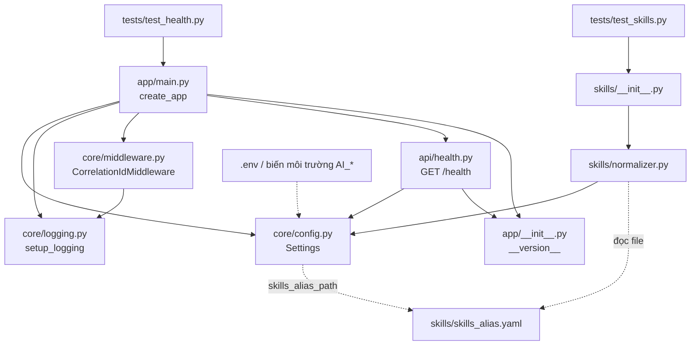
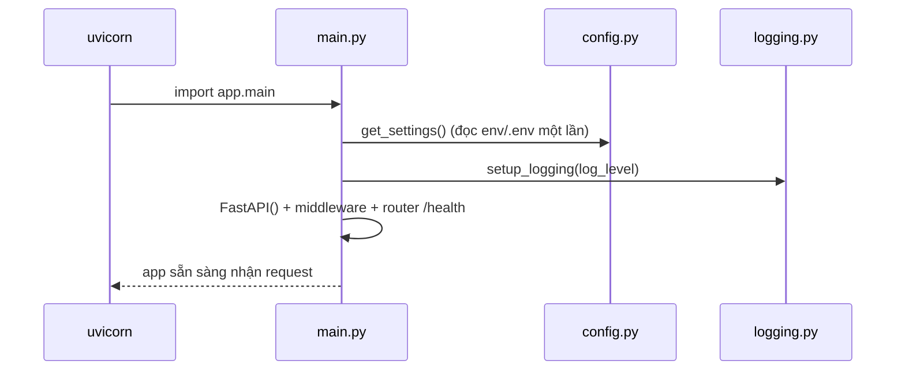
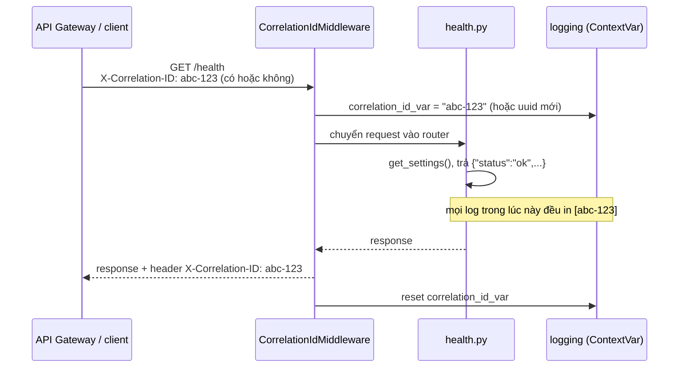
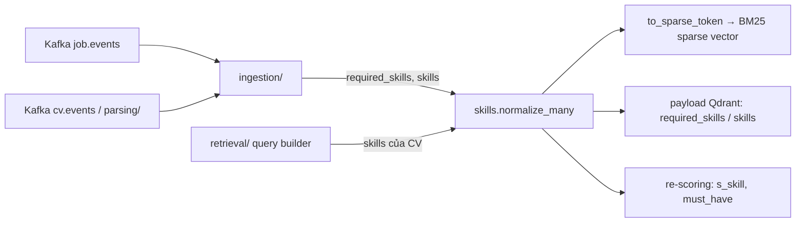

# AI Matching: giải thích phần khung ban đầu

> Branch: `Dung_Branch` · Ngày: 2026-11-01
> Phạm vi: khung FastAPI (config, health check, logging có correlation-id) và module chuẩn hóa skill.
> Thuộc **Phase 4** trong [`ARCHITECTURE.md`](../../ARCHITECTURE.md).

---

## 1. Tóm tắt những gì đã làm

| # | Việc | Kết quả |
|---|------|---------|
| 1 | Tạo folder `ai-matching/` cho toàn bộ code AI | Service Python 3.11 + FastAPI độc lập với backend Java |
| 2 | Khung ứng dụng FastAPI | Chạy được, có endpoint `GET /health` |
| 3 | Cấu hình qua biến môi trường | Mọi thông số đọc từ env `AI_*` hoặc file `.env`, không hard-code |
| 4 | Logging có correlation-id | Mỗi dòng log mang id của request, để lần theo một request đi qua gateway → ai-matching |
| 5 | Chuẩn hóa skill | `ReactJS`, `react.js` → `react`; `k8s` → `kubernetes`; ... dùng chung cho job và CV |
| 6 | Test tự động | 23 test (pytest) pass, ruff lint sạch |
| 7 | Đổi tên `ai-service` → `ai-matching` | Sửa trong `.github/workflows/ci.yml` và `ARCHITECTURE.md` |
| 8 | Quản lý dependency bằng `uv` | `pyproject.toml` + `uv.lock` (khóa phiên bản để mọi máy cài giống nhau) |

---

## 2. Cây thư mục

```
ai-matching/
├── pyproject.toml            # Khai báo project, dependency, cấu hình pytest + ruff
├── uv.lock                   # Phiên bản chính xác của mọi thư viện (uv tự sinh)
├── .python-version           # 3.11: uv dùng đúng phiên bản Python này
├── .env.example              # Mẫu biến môi trường, copy thành .env khi chạy local
├── README.md                 # Hướng dẫn chạy nhanh
├── Dockerfile                # Đóng gói service thành image (2 stage)
├── .dockerignore             # Loại file thừa/bí mật khỏi image
├── docs/
│   └── 01-khung-ban-dau.md   # File này
├── app/
│   ├── __init__.py           # __version__ = "0.1.0"
│   ├── main.py               # Điểm vào: create_app() lắp ráp mọi thứ
│   ├── core/
│   │   ├── config.py         # Settings: đọc cấu hình từ env
│   │   ├── logging.py        # Định dạng log + gắn correlation-id
│   │   └── middleware.py     # Nhận/sinh X-Correlation-ID cho mỗi request
│   ├── api/
│   │   └── health.py         # GET /health
│   ├── skills/
│   │   ├── __init__.py       # Xuất các hàm public của module skills
│   │   ├── normalizer.py     # Logic chuẩn hóa skill
│   │   └── skills_alias.yaml # Bảng alias: <tên chuẩn>: [alias, ...]
│   ├── ingestion/            # (trống) Phase 4: Kafka → embedding → Qdrant
│   ├── parsing/              # (trống) Phase 4: PDF → text → JSON CV
│   ├── retrieval/            # (trống) Phase 5: hybrid search, filter, re-score
│   └── explain/              # (trống) Phase 5: LLM sinh giải thích
└── tests/
    ├── test_health.py        # Test /health và correlation-id
    └── test_skills.py        # Test chuẩn hóa skill
```

---

## 3. Công dụng chi tiết từng file

### 3.1 File cấu hình project

#### `pyproject.toml`
File "hộ chiếu" của project Python, tương tự `pom.xml` bên Java.

- `[project] dependencies`: thư viện cần để **chạy** service:
  - `fastapi`: web framework.
  - `uvicorn[standard]`: server ASGI chạy FastAPI.
  - `pydantic`, `pydantic-settings`: validate dữ liệu và đọc cấu hình từ env.
  - `pyyaml`: đọc file `skills_alias.yaml`.
- `[project.optional-dependencies] dev`: chỉ cần khi **phát triển/test**: `pytest`, `httpx` (để `TestClient` gọi API giả lập), `ruff` (lint).
- `[tool.hatch.build.targets.wheel] packages = ["app"]`: cho biết code nằm trong package `app`.
- `[tool.pytest.ini_options]`: pytest tìm test trong `tests/`.
- `[tool.ruff]`: quy tắc lint (dòng tối đa 100 ký tự, sắp xếp import, cú pháp Python hiện đại, bắt lỗi phổ biến).

#### `uv.lock`
Do `uv sync` sinh ra. Ghi lại **phiên bản chính xác** của từng thư viện (kể cả thư viện con). Commit file này để cả nhóm và CI cài giống hệt nhau. Không sửa tay.

#### `.python-version`
Chứa `3.11`. `uv` đọc file này để tạo `.venv` đúng Python 3.11 (khớp với `PYTHON_VERSION` trong CI), dù máy đang có Python 3.12.

#### `.env.example`
Mẫu các biến môi trường. Khi chạy local: `cp .env.example .env` rồi điền giá trị (ví dụ `AI_OPENAI_API_KEY`). File `.env` thật **không commit** vì chứa secret.

#### `Dockerfile`
Đóng gói ai-matching thành Docker image, gồm 2 stage:

1. **builder** (`python:3.11-slim-bookworm` + binary `uv` 0.13.6, trùng bản đã sinh `uv.lock`):
   - Chỉ copy `pyproject.toml` và `uv.lock` trước, rồi `uv sync --frozen --no-install-project`. Nhờ vậy Docker cache lại layer dependency: sửa code trong `app/` không làm cài lại thư viện.
   - `--frozen`: cài đúng theo `uv.lock`, lock lệch với `pyproject.toml` thì báo lỗi thay vì tự cập nhật.
   - Không có `--extra dev`, nên `pytest`, `httpx`, `ruff` **không** vào image.
   - Venv đặt ở `/opt/venv`; `UV_PYTHON_DOWNLOADS=never` bắt uv dùng Python có sẵn của image.
2. **runtime** (cùng base image, không có `uv`):
   - Chỉ copy `/opt/venv` và thư mục `app/` (gồm cả `skills_alias.yaml`), nên image nhỏ.
   - Chạy bằng user `appuser` (uid 10001), không phải root.
   - `HEALTHCHECK` gọi `GET /health` bằng Python (image slim không có `curl`), dùng cho `docker ps` và `depends_on: condition: service_healthy` trong docker-compose sau này.
   - Khởi động: `uvicorn app.main:app --host 0.0.0.0 --port 8000`.

Cấu hình truyền vào lúc chạy bằng biến môi trường `AI_*` (`--env-file .env` hoặc `environment:` trong compose). File `.env` không nằm trong image.

#### `.dockerignore`
Loại khỏi build context: `.venv/`, cache (`__pycache__`, `.pytest_cache`, `.ruff_cache`), `.env*` (tránh lộ secret vào image), `tests/`, `docs/`, `README.md`. Build nhanh hơn và image sạch hơn.

---

### 3.2 `app/`: mã nguồn

#### `app/__init__.py`
Đánh dấu `app` là một package Python và khai báo `__version__ = "0.1.0"`. Version này được `main.py` (tiêu đề Swagger) và `/health` dùng chung, nên chỉ cần sửa ở một chỗ.

#### `app/main.py`: điểm vào, "lắp ráp" ứng dụng
Hàm `create_app()` làm theo thứ tự:

1. `get_settings()`: lấy cấu hình.
2. `setup_logging(settings.log_level)`: cài đặt logging.
3. Tạo `FastAPI(...)`.
4. `add_middleware(CorrelationIdMiddleware)`: mọi request đều đi qua middleware này trước.
5. `include_router(health.router)`: gắn các endpoint.
6. Ghi log "Khởi động ai-matching (env=dev)".

Biến `app = create_app()` ở cuối là thứ `uvicorn app.main:app` tìm để chạy.
Sau này thêm router mới (ví dụ `/ai/recommendations/jobs`) thì chỉ cần thêm một dòng `include_router` ở đây.

#### `app/core/config.py`: cấu hình
- Class `Settings` kế thừa `BaseSettings` của pydantic-settings. Mỗi thuộc tính tự đọc từ biến môi trường có tiền tố `AI_`, ví dụ `log_level` ← `AI_LOG_LEVEL`. Không có env thì dùng giá trị mặc định.
- Pydantic tự ép kiểu và validate (ví dụ `skills_alias_path` là `Path`).
- Đã khai báo sẵn `qdrant_url`, `kafka_bootstrap_servers`, `redis_url`, `openai_api_key` để Phase 4 dùng, hiện chưa có code nào gọi tới.
- `get_settings()` có `@lru_cache`: chỉ đọc env **một lần**, các lần sau trả lại cùng object.

#### `app/core/logging.py`: log có correlation-id
- `correlation_id_var` là một `ContextVar`: biến "theo từng request". Hai request chạy song song (async) mỗi bên thấy giá trị riêng, không đè nhau. Mặc định là `"-"` (log lúc khởi động, không thuộc request nào).
- `CorrelationIdFilter`: trước khi in mỗi dòng log, gắn `correlation_id` hiện tại vào record.
- `setup_logging()`: cài handler in ra stdout theo định dạng:
  ```
  2026-11-01 10:00:00,123 INFO [3f2a...c9] app.main: Khởi động ai-matching (env=dev)
  ```
- Sau này Kafka consumer chỉ cần `correlation_id_var.set(<id lấy từ Kafka header>)` là log của consumer cũng có id, nối được với log của gateway và job-service.

#### `app/core/middleware.py`: nhận/sinh correlation-id
`CorrelationIdMiddleware` là ASGI middleware, bọc ngoài toàn bộ app:

1. Đọc header `X-Correlation-ID` của request. Gateway đã gửi thì dùng lại, không có thì sinh mới bằng `uuid4().hex` (32 ký tự).
2. `correlation_id_var.set(...)`: từ đây mọi log trong request này mang id đó.
3. Khi response bắt đầu gửi, gắn lại header `X-Correlation-ID` vào response để client/gateway biết.
4. `finally: reset(token)`: trả biến về giá trị cũ, không rò sang request khác.

Viết dạng ASGI thuần (không dùng `BaseHTTPMiddleware`) vì nhẹ hơn và không ảnh hưởng streaming response.

#### `app/api/health.py`: health check
`GET /health` trả về:
```json
{"status": "ok", "service": "ai-matching", "version": "0.1.0"}
```
Dùng cho Docker healthcheck, gateway, hoặc kiểm tra nhanh service còn sống. Sau này có thể mở rộng thành kiểm tra kết nối Qdrant/Kafka/Redis.

#### `app/skills/skills_alias.yaml`: bảng alias
Dạng `<tên chuẩn>: [alias, ...]`, ví dụ:
```yaml
kubernetes: [k8s, kube]
spring boot: [springboot]
postgresql: [postgres, psql, pgsql]
```
- Khoảng 50 skill, chia nhóm: ngôn ngữ, backend, frontend, database, messaging, DevOps, AI, chứng chỉ.
- **Không cần** khai báo các biến thể chỉ khác hoa/thường hay `-`/`_` (như `Spring-Boot`, `spring_boot`), vì normalizer tự xử lý.
- Đã cố ý bỏ các alias dễ nhầm (`es`, `tf`, `github → git`).
- Muốn thêm skill: chỉ sửa file này, không cần sửa code.

#### `app/skills/normalizer.py`: logic chuẩn hóa
Theo ARCHITECTURE.md mục 3.10, đây là **điều kiện để sparse search (BM25) và điểm `s_skill` chạy đúng**. Job ghi "ReactJS" và CV ghi "react.js" phải trở thành cùng một token, nếu không sẽ không khớp.

| Hàm / class | Việc làm |
|-------------|----------|
| `clean_skill(raw)` | NFC Unicode (quan trọng cho tiếng Việt), lowercase, `-` `_` và khoảng trắng thừa → một dấu cách, bỏ dấu câu bao quanh như `(Docker),` → `docker`. Giữ `.` `+` `#` `/` bên trong vì có nghĩa: `node.js`, `c++`, `c#`, `ci/cd`. |
| `SkillNormalizer.__init__(aliases)` | Dựng bảng tra `{dạng đã làm sạch → tên chuẩn}`. Nếu một alias trỏ vào **2 skill khác nhau** thì báo `ValueError` ngay khi khởi động, tránh lỗi âm thầm. |
| `SkillNormalizer.from_yaml(path)` | Đọc file YAML và tạo normalizer. |
| `normalize(raw)` | Làm sạch rồi tra bảng. Không có trong bảng thì giữ dạng đã làm sạch (`Apache-Flink` → `apache flink`). |
| `normalize_many(list)` | Chuẩn hóa cả danh sách, bỏ rỗng, bỏ trùng, **giữ thứ tự**: `["ReactJS","k8s","react.js"]` → `["react","kubernetes"]`. |
| `to_sparse_token(skill)` | `"spring boot"` → `"spring_boot"` để BM25 coi là một token, không khớp nhầm "spring" rời (ARCHITECTURE.md mục 3.6). |
| `get_normalizer()` | Đọc YAML theo `settings.skills_alias_path`, có `@lru_cache` nên chỉ đọc file một lần. |

#### `app/skills/__init__.py`
Xuất `SkillNormalizer`, `get_normalizer`, `to_sparse_token` để nơi khác import gọn: `from app.skills import get_normalizer`.

#### `app/ingestion/`, `app/parsing/`, `app/retrieval/`, `app/explain/`
Hiện chỉ có `__init__.py` với docstring mô tả nhiệm vụ. Đây là chỗ cho code Phase 4–5, tạo trước để cấu trúc khớp với ARCHITECTURE.md mục 2.1.

---

### 3.3 `tests/`

#### `tests/test_health.py` (3 test)
- `/health` trả 200 và đúng `service`.
- Gửi `X-Correlation-ID: abc-123` thì response trả lại đúng `abc-123`.
- Không gửi thì service tự sinh id dài 32 ký tự.

#### `tests/test_skills.py` (20 test)
- 14 trường hợp alias (`ReactJS`, `k8s`, `Spring-Boot`, `C#`, `cpp`, `CI/CD`, `(Docker),`...).
- Skill lạ được làm sạch nhưng giữ nguyên.
- Tiếng Việt dạng NFD (dấu tách rời) được đưa về NFC.
- `normalize_many` bỏ trùng và giữ thứ tự.
- `to_sparse_token`.
- Alias xung đột bị từ chối.
- Tên chuẩn chuẩn hóa ra chính nó (`spring boot`, `node.js`, `c++`, `aws saa`).

---

### 3.4 File sửa ngoài `ai-matching/`

| File | Thay đổi | Lý do |
|------|----------|-------|
| `.github/workflows/ci.yml` | `ai-service` → `ai-matching` (đường dẫn, tên job, `needs`) | CI phát hiện thay đổi trong `ai-matching/` và chạy ruff + pytest |
| | `pip install -e .` → `pip install -e ".[dev]"` | Cài thêm `httpx`, nếu thiếu thì test `/health` lỗi trên CI |
| `ARCHITECTURE.md` | `ai-service` → `ai-matching` (trên 20 dòng) | Tài liệu khớp với tên folder thật |

---

## 4. Các file kết nối với nhau như thế nào

### 4.1 Sơ đồ phụ thuộc (ai import ai)



Hai nhánh hiện **độc lập**:
- **Nhánh web** (`main` → `core` → `api`): nhận HTTP request.
- **Nhánh skills**: thư viện thuần, chưa có endpoint nào gọi. Phase 4–5 mới dùng (xem 4.4).

Điểm chung duy nhất là `core/config.py`: mọi thứ lấy cấu hình từ đây.

### 4.2 Luồng khởi động



### 4.3 Luồng một request `GET /health`



### 4.4 Skills sẽ được dùng ở đâu (Phase 4–5)



Chuẩn hóa skill phải **giống hệt** ở cả lúc index (job/CV vào Qdrant) và lúc query, nên mọi nơi đều gọi chung `get_normalizer()`, không tự viết logic riêng.

---

## 5. Cách chạy

```bash
cd ai-matching
uv sync --extra dev                       # tạo .venv (Python 3.11) và cài dependency
cp .env.example .env
uv run uvicorn app.main:app --reload --port 8000
curl -i localhost:8000/health             # xem cả header X-Correlation-ID
# Swagger UI: http://localhost:8000/docs

uv run pytest                             # 23 passed
uv run ruff check .                       # All checks passed!
```

Chạy bằng Docker:

```bash
docker build -t smarthr/ai-matching:dev .
docker run --rm -p 8000:8000 --env-file .env smarthr/ai-matching:dev
curl localhost:8000/health
docker ps                                 # cột STATUS hiện (healthy) sau khoảng 10 giây
```

---

## 6. Bước tiếp theo (Phase 4)

- [x] Dockerfile + `.dockerignore`
- [ ] Tokenizer tiếng Việt (`underthesea` / `pyvi`) cho BM25
- [ ] Parse PDF: `pdfplumber` + OCR fallback + `gpt-4o-mini` Structured Outputs → `CvSchema` (`app/parsing/`)
- [ ] Tạo collection Qdrant `jobs`, `candidates` (dense + sparse + payload index)
- [ ] Kafka consumers `job.events`, `cv.events` → embed → upsert Qdrant, idempotent (`app/ingestion/`)
- [ ] Script `reindex` rebuild Qdrant từ Postgres
