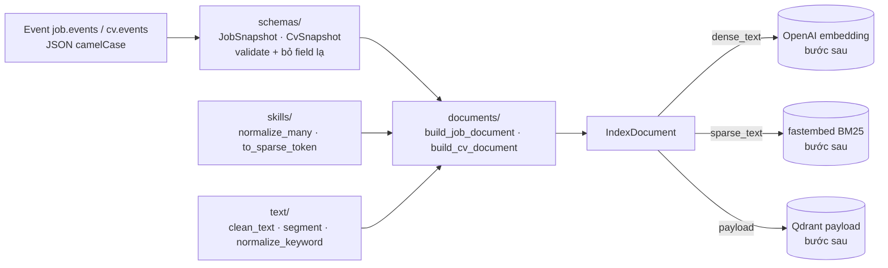

# AI Matching: Document builder và tách từ tiếng Việt

> Branch: `Dung_Branch` · Ngày: 2026-11-15
> Phạm vi: biến dữ liệu job/CV thành "document" sẵn sàng index vào Qdrant. **Chưa** gọi OpenAI, chưa encode BM25, chưa ghi vào Qdrant (để bước sau).
> Thuộc **Phase 4** trong [`ARCHITECTURE.md`](../../ARCHITECTURE.md), dựa theo mục 3.4, 3.5, 3.6 và 3.10.

---

## 1. Tóm tắt

| # | Việc | Kết quả |
|---|------|---------|
| 1 | Schema Pydantic cho dữ liệu vào | `JobSnapshot`, `CvSnapshot` (snapshot trong event), `CvSchema` (kết quả parse PDF) |
| 2 | Làm sạch văn bản | Bỏ HTML, chuẩn hóa NFC, **loại PII** (email, SĐT Việt Nam, URL), gọn khoảng trắng, cắt độ dài |
| 3 | Tách từ tiếng Việt | `pyvi`: "Phát triển phần mềm" → `phát_triển phần_mềm` |
| 4 | Token skill cho BM25 | `c++` → `c_plus_plus`, `node.js` → `node_dot_js` (sửa lỗi BM25 cắt mất ký hiệu) |
| 5 | Document builder | Job/CV → `IndexDocument` gồm `dense_text`, `sparse_text`, `payload` |
| 6 | Test | Tổng 67 test pass (thêm 44), ruff sạch |

Dependency mới: `pyvi` (kéo theo `scikit-learn`, `scipy`, `numpy`, khoảng 190MB). Image Docker sẽ lớn hơn tương ứng.

---

## 2. File mới / sửa

```
app/
├── schemas/
│   ├── common.py        # CamelModel + enum Level, JobType, WorkMode, JobStatus
│   ├── job.py           # JobSnapshot
│   └── cv.py            # CvContent, CvSchema, CvSnapshot và các phần con
├── text/
│   ├── cleaning.py      # strip_html, scrub_pii, clean_text, truncate, normalize_keyword
│   └── vietnamese.py    # segment(): tách từ tiếng Việt bằng pyvi
├── documents/
│   ├── base.py          # IndexDocument + hàm tiện ích dựng text/payload
│   ├── job.py           # build_job_document()
│   └── cv.py            # build_cv_document()
├── skills/normalizer.py # (sửa) to_sparse_token xử lý ký hiệu + . # /
└── core/config.py       # (sửa) thêm embedding_version, document_max_chars
tests/
├── test_text.py         # làm sạch, PII, tách từ
├── test_documents.py    # job/CV document, PII không lọt
└── test_skills.py       # (sửa) thêm case cho to_sparse_token
```

---

## 3. Luồng dữ liệu



`IndexDocument` là "điểm bàn giao": phần ingestion (Kafka → Qdrant) ở bước sau chỉ cần lấy 3 thứ này đi encode và upsert, không phải biết gì về cấu trúc job/CV.

---

## 4. Chi tiết từng phần

### 4.1 `schemas/`: hợp đồng dữ liệu vào

- **`CamelModel`**: nhận JSON **camelCase** từ service Java (`jobId`, `requiredSkills`), vẫn chấp nhận snake_case. `extra="ignore"`: field không khai báo bị bỏ qua. Nhờ vậy nếu event lỡ chứa `email`, `fullName` thì chúng **không đi tiếp** vào pipeline.
- **`JobSnapshot`**: theo bảng JOB + JOB_SKILL ở mục 3.10. Kiểm tra:
  - `deadline`, `publishedAt` **bắt buộc có múi giờ** (`2026-12-31T23:59:59+07:00`), vì so sánh hạn nộp sai múi giờ là lọt job hết hạn.
  - `salaryMin <= salaryMax`, lương và số năm kinh nghiệm không âm.
- **CV có 3 lớp**:
  - `CvContent`: nội dung CV, **không có PII**.
  - `CvSchema` = `CvContent` + `full_name`, `email`, `phone`: kết quả parse PDF trả cho User xem lại (bước parse sẽ dùng).
  - `CvSnapshot` = `CvContent` + `cv_id`, `user_id`, `searchable`, `version`, `updated_at`: snapshot trong `cv.events`. `searchable` mặc định `false` (HR chỉ tìm thấy khi User chủ động bật).
- Experience dùng key `from` / `to` đúng như CvSchema trong ARCHITECTURE.md (trong Python là `from_date` / `to_date` vì `from` là từ khóa).

### 4.2 `text/cleaning.py`: làm sạch và loại PII

`clean_text(text, max_chars)` chạy theo thứ tự: NFC → bỏ HTML (thẻ khối như `<p>`, `<li>` thành xuống dòng, `&amp;` → `&`) → **loại PII** → gọn khoảng trắng → cắt độ dài (không cắt ngang từ).

PII bị loại:

| Loại | Ví dụ bị loại | Ví dụ được giữ |
|------|---------------|----------------|
| Email | `hr@abc.vn` | |
| SĐT Việt Nam (bắt đầu `0` hoặc `+84`) | `0912345678`, `0912.345.678`, `+84 912 345 678`, `024 3826 1234` | `20000000` (lương), `2020-2023`, `+5 năm` |
| URL | `https://linkedin.com/in/...`, `www.facebook.com/...` | `node.js` |

`normalize_keyword()`: giá trị keyword trong payload (`location`, `industry`) được NFC + lowercase + gọn khoảng trắng: `"  Hà   Nội "` → `"hà nội"`. **Filter lúc search phải đi qua đúng hàm này** thì mới khớp.

### 4.3 `text/vietnamese.py`: tách từ

`segment("Phát triển phần mềm tại Hà Nội!")` → `["phát_triển", "phần_mềm", "tại", "hà_nội"]`

- Dùng `pyvi`, sau đó lowercase và bỏ token chỉ là dấu câu.
- **Xử lý thêm:** `pyvi` nối cả từ tiếng Anh một cách không nhất quán (`Senior Java Backend_Developer` nhưng `Java_Backend` ở câu khác), làm BM25 trượt. Vì vậy token ghép **chỉ gồm ký tự ASCII** được tách lại thành từ rời. Đánh đổi: từ ghép tiếng Việt không dấu như "kinh doanh" cũng bị tách thành `kinh` `doanh`, nhưng vẫn nhất quán giữa lúc index và lúc query.
- `pyvi` nạp model mất khoảng 2 giây, nên được **import trễ** (lần đầu gọi `segment()`), không làm chậm khởi động app.

### 4.4 `skills/normalizer.py`: `to_sparse_token` (sửa)

Tokenizer BM25 của fastembed bỏ mọi ký tự không phải chữ/số. Trước đây `to_sparse_token("node.js")` trả `node.js` và BM25 sẽ cắt thành `node` + `js`, còn `c++` chỉ còn `c`. Giờ ký hiệu được đổi thành chữ:

| Skill | Token |
|-------|-------|
| `spring boot` | `spring_boot` |
| `c++` | `c_plus_plus` |
| `c#` | `c_sharp` |
| `node.js` | `node_dot_js` |
| `.net` | `dot_net` |
| `ci/cd` | `ci_cd` |

### 4.5 `documents/`: dựng IndexDocument

**Job** (`build_job_document`), đúng định dạng mục 3.4:

```
Title: Senior Java Backend Developer
Level: SENIOR | Industry: IT-Software | Type: FULL_TIME
Required skills: java, spring boot, postgresql, kafka, docker
Nice to have: kubernetes, aws
Description: Phát triển hệ thống microservices với Spring Boot & Kafka. ...
```

- Skill được chuẩn hóa. Skill `mustHave` **tự động thuộc required**. Skill nice-to-have trùng với required bị bỏ.
- Mô tả cắt tối đa `document_max_chars` (mặc định 6.000 ký tự, khoảng 1.500 token).
- `sparse_text` = tách từ tiêu đề + token skill (required, nice) + tách từ mô tả.
- `payload` có đủ các field ở bảng mục 3.4, cộng thêm `must_have_skills` (cần cho luật loại cứng ở mục 3.6). Thời gian chuyển về **UTC ISO** (`deadline_ts: "2026-12-31T16:59:59+00:00"`), enum thành chuỗi.

**CV** (`build_cv_document`):

```
Headline: Lập trình viên Java Backend
Level: MIDDLE | Experience: 3.5 years
Skills: spring boot, postgresql, c#
Certifications: aws saa
Languages: English (IELTS 6.5)
Experience:
- Backend Developer at ABC Corp (2022-01 – present): Xây dựng API thanh toán. ...
Education: Bachelor Computer Science
```

- `sparse_text` theo đúng ví dụ mục 3.6: token skill + token chứng chỉ + tách từ headline, ví dụ `spring_boot postgresql c_sharp aws_saa lập_trình_viên java backend`.
- Cùng `dense_text` / `sparse_text` này sẽ được dùng làm **query** khi gợi ý job cho User (Phase 5), nên index CV và query luôn nhất quán.
- **Không có PII**: không dùng `full_name`/`email`/`phone`, và mọi văn bản tự do (summary, headline...) đều qua `clean_text()`. Có test riêng kiểm tra tên, email, SĐT không xuất hiện trong dense, sparse lẫn payload.

### 4.6 Config mới

| Biến môi trường | Mặc định | Ý nghĩa |
|-----------------|----------|---------|
| `AI_EMBEDDING_VERSION` | `text-embedding-3-small@v1` | Ghi vào payload; đổi khi đổi model hoặc cách dựng document để biết cần re-index |
| `AI_DOCUMENT_MAX_CHARS` | `6000` | Giới hạn độ dài mô tả job / phần kinh nghiệm CV |

---

## 5. Bản nháp hợp đồng event (cần nhóm duyệt)

`JobSnapshot` chính là đề xuất cho phần `payload` của event `job.events`. Ví dụ JSON job-service cần gửi:

```json
{
  "jobId": "6f1c...", "companyId": "a2b3...",
  "title": "Senior Java Backend Developer",
  "description": "<p>...</p>",
  "status": "OPEN",
  "level": "SENIOR", "industry": "IT-Software", "jobType": "FULL_TIME", "workMode": "HYBRID",
  "location": "Hà Nội",
  "salaryMin": 30000000, "salaryMax": 50000000, "minYearsExp": 3,
  "requiredSkills": ["java", "spring boot"], "niceToHaveSkills": ["kubernetes"], "mustHaveSkills": ["java"],
  "deadline": "2026-12-31T23:59:59+07:00", "publishedAt": "2026-11-15T09:00:00+07:00"
}
```

Cần chốt với nhóm backend:
- Danh sách giá trị enum `level` (đang đề xuất `INTERN, FRESHER, JUNIOR, MIDDLE, SENIOR, LEAD, MANAGER`), `jobType`, `workMode`, `status`.
- Thời gian luôn kèm múi giờ (ISO-8601 có offset).
- Tương tự cho `CvSnapshot` trong `cv.events`: **không** gửi họ tên, email, SĐT.

---

## 6. Còn để ngỏ

- **Chuẩn hóa địa điểm**: hiện chỉ lowercase (`"Hà Nội"` → `"hà nội"`); `"HN"`, `"Ha Noi"`, `"TP.HCM"` vs `"Hồ Chí Minh"` chưa được gộp. Nên có bảng alias như skill.
- **Tự tính số năm kinh nghiệm** từ danh sách experiences khi CV không ghi `yearsExperience`.
- Sau khi loại PII có thể còn dấu câu thừa (`"Liên hệ: ,"`), không ảnh hưởng ý nghĩa nhưng có thể làm gọn thêm.

## 7. Bước tiếp theo

- [ ] Qdrant: tạo collection `jobs`, `candidates` (dense + sparse + payload index), upsert `IndexDocument`
- [ ] Encode: OpenAI embedding cho `dense_text`, fastembed BM25 cho `sparse_text`
