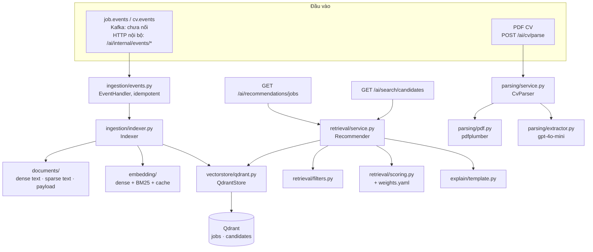

# AI Matching: Encode, Qdrant, gợi ý và parse CV

> Branch: `Dung_Branch` · Ngày: 2026-11-22
> Phạm vi: các phần **không phải chờ nhóm khác** của Phase 4 và Phase 5 trong [`ARCHITECTURE.md`](../../ARCHITECTURE.md).
> Kết quả: 156 test pass, ruff sạch, đã chạy thử trên server uvicorn thật (Qdrant chạy trong RAM).

---

## 1. Tóm tắt

| # | Tính năng | Commit | Trạng thái |
|---|-----------|--------|-----------|
| 1 | Encode: dense (OpenAI / hashing), sparse BM25, cache embedding (RAM / Redis) | `6c3b50a` | ✅ |
| 2 | Qdrant store, indexer, xử lý `job.events` / `cv.events` (idempotent) | `07be6d1` | ✅ (chưa nối Kafka) |
| 3 | Hybrid search + re-scoring + API gợi ý job / tìm ứng viên | `c84148a` | ✅ |
| 4 | Parse CV từ PDF: `POST /ai/cv/parse` | `70cb9f4` | ✅ (chưa OCR, chưa chạy OpenAI thật) |

---

## 2. Kiến trúc trong ai-matching



Mọi thành phần được khởi tạo một lần trong `core/container.py` (lúc FastAPI khởi động) và dùng chung.

---

## 3. Tính năng 1: Encode (`app/embedding/`)

| File | Việc |
|------|------|
| `sparse.py` | `Bm25Encoder`: tính phần TF của BM25 (k1=1.2, b=0.75), IDF do Qdrant tự tính (`modifier=IDF`). Token → chỉ số bằng hash `blake2b` ổn định |
| `dense.py` | `OpenAIEmbedder` (text-embedding-3-small, gửi theo lô 128, giữ đúng thứ tự); `HashingEmbedder` cho dev/test không cần key; `CachedDenseEmbedder` chỉ embed văn bản chưa có trong cache |
| `cache.py` | Cache theo `sha256(text)`: `InMemoryEmbeddingCache` (LRU) hoặc `RedisEmbeddingCache` (float32 nhị phân, TTL 30 ngày) |
| `factory.py` | Chọn embedder và cache theo cấu hình |

**Vì sao tự viết BM25 thay vì `fastembed`** (khác với bản đầu của ARCHITECTURE.md, đã cập nhật):
- `fastembed` kéo theo `onnxruntime` (>100MB) và phải tải model từ HuggingFace lúc chạy.
- Tokenizer của nó stem tiếng Anh lên cả token tiếng Việt.
- Văn bản của ta đã được tách từ sẵn ở `documents/`, nên chỉ còn bước tính trọng số (khoảng 40 dòng).

**`HashingEmbedder` chỉ dùng cho dev/test:** nó không hiểu ngữ nghĩa ("Backend Engineer" không gần "Java Developer"). Chạy thật phải dùng `AI_EMBEDDING_PROVIDER=openai`.

---

## 4. Tính năng 2: Qdrant và xử lý event

### `vectorstore/qdrant.py`: `QdrantStore`
- `ensure_collections()`: tạo collection `jobs` và `candidates` (vector `dense` cosine + `sparse` IDF) cùng payload index theo bảng ở ARCHITECTURE.md mục 3.4. Chạy lúc khởi động, chạy lại nhiều lần vẫn an toàn.
- `upsert`, `delete`, `get` (đọc lại cả vector).
- `set_payload` lọc theo id nghiệp vụ (`job_id` / `cv_id`) thay vì point id, nên **không lỗi** khi point chưa tồn tại.
- `point_id()`: Qdrant chỉ nhận UUID hoặc số; id dạng khác được băm `uuid5` cố định.

### `ingestion/indexer.py`: `Indexer`
Snapshot → `build_*_document` → embed (theo lô) → upsert.
Khi job chỉ sửa metadata (lương, hạn nộp), văn bản không đổi nên cache trả lại vector cũ, **không gọi OpenAI lại** (đúng yêu cầu mục 3.4, có test kiểm chứng).

### Hợp đồng với job-service (`schemas/events.py`)

Message trên topic `job.events` (key = jobId) đúng như job-service gửi, xem `backend/job-service/DATAFORAISERVICE.md`:

```json
{
  "eventId": "uuid", "type": "job.created", "version": 1, "occurredAt": "...",
  "producer": "job-service", "correlationId": "...",
  "data": {
    "id": "uuid", "companyId": "uuid", "companyName": "FPT Software",
    "title": "...", "description": "...", "level": "JUNIOR", "jobType": "INTERNSHIP",
    "workMode": "HYBRID", "salaryMin": 15000000, "salaryMax": null, "minYearsExp": 0,
    "location": {"id": "uuid", "name": "Cầu Giấy", "parentId": "uuid-Hà-Nội"},
    "industry": {"id": "uuid", "name": "Công nghệ thông tin", "parentId": null},
    "deadline": "...", "status": "OPEN", "version": 3, "publishedAt": "...",
    "skills": [{"skill": "Java", "mustHave": true, "required": true}]
  }
}
```

- `EventEnvelope` khớp `EventEnvelope.java` (common-lib); `JobRes`, `LocationRes`, `IndustryRes`, `JobSkillRes` khớp DTO `dto/res` của job-service. Trường thừa (`createdBy`, `createdAt`...) bị bỏ qua.
- `JobRes.to_snapshot()` chuyển sang `JobSnapshot` (mô hình nội bộ). Phân loại skill: `mustHave=true` → must_have; `required=true` (hoặc null) → bắt buộc; còn lại → nice-to-have.
- `JobType` có đủ `INTERNSHIP`, `FREELANCE` như job-service.
- Payload Qdrant có thêm cho FE: `company_name`, `location_name`, `industry_name` (dạng gốc để hiển thị), `location_ids` / `industry_ids` (id của nó + id cấp cha), `version`.
- Message sai (ví dụ `salaryMin > salaryMax`, `type` lạ) bị từ chối ngay lúc parse (422), không lọt xuống bước index.

### `ingestion/events.py`: `EventHandler`

| Event | Hành động |
|-------|-----------|
| `job.created`, `job.updated`, `job.closed` | Index lại toàn bộ từ `JobRes` trong `data` (closed giữ point cho thống kê, `status = CLOSED`) |
| `job.expired` | Như trên, ép `status = CLOSED` |
| `job.deleted` | Xóa point |
| `cv.saved` | Index lại |
| `cv.visibility_changed` | Cập nhật `searchable` |
| `cv.deleted` | Xóa point ("right to be forgotten") |

- **Idempotent:** mỗi `eventId` chỉ xử lý một lần (lưu ở RAM hoặc Redis, TTL 7 ngày). Kafka có thể giao lại event cũ; có test bảo đảm event `created` giao lại sau khi đã `deleted` không làm job "sống lại".
- **Bỏ event cũ đến muộn:** nếu `data.version` nhỏ hơn version của bản đang index thì bỏ qua.
- **Chưa nối Kafka**: consumer chỉ cần parse value của message thành `JobEvent` rồi gọi `handle_job` (job), tương tự với CV.
- **API nội bộ thay Kafka khi dev:** `POST /ai/internal/events/job` và `/cv`, nhận đúng message Kafka qua HTTP. **Mặc định tắt**, bật bằng `AI_INTERNAL_API_ENABLED=true`. Không được mở route này qua API gateway.

---

## 5. Tính năng 3: Gợi ý (`app/retrieval/`, `app/explain/`)

### Pipeline (`retrieval/service.py`)
1. Đọc point nguồn (CV hoặc job) **kèm vector** từ Qdrant. Chưa index → 404. Nhờ vậy lúc search **không gọi OpenAI**.
2. Hard filter (`filters.py`), đặt **trong prefetch**:
   - Job: `status = OPEN`, `deadline_ts >= now`, location / jobType / industry, lương (job "thỏa thuận" vẫn qua), loại job đã apply (`excludeJobIds`).
   - Ứng viên: chỉ CV `searchable = true`, cùng location / level / số năm tối thiểu.
3. Prefetch dense top-50 + sparse top-50, fusion RRF → top-50.
4. Re-score (`scoring.py`) với trọng số ở `weights.yaml`, rồi áp luật cứng: thiếu skill `must_have`, hoặc `s_skill < 0.3`, hoặc `final < τ = 0.35` thì **loại**.
5. Đa dạng hóa: mỗi công ty tối đa 3 job.
6. Giải thích (`explain/template.py`): matched / missing skills, nhận xét cấp bậc, kinh nghiệm, lương, gợi ý bổ sung.

Khi thiếu dữ liệu ở một vế (CV không ghi level, job lương thỏa thuận...), điểm thành phần là 0.5 (trung lập).

### API

```
GET /ai/recommendations/jobs?cvId=...&locationId=<uuid>&industryId=<uuid>&jobType=INTERNSHIP
                            &salaryMin=30000000&excludeJobIds=a&excludeJobIds=b&limit=10
# locationId / industryId: id lấy từ GET /api/v1/locations, /api/v1/industries của job-service
# (khuyến nghị). Chọn tỉnh thì ra cả job ở quận thuộc tỉnh đó. Vẫn hỗ trợ lọc theo tên:
# location=Hà Nội&industry=...
GET /ai/search/candidates?jobId=...&location=...&level=SENIOR&minYears=3&limit=20
```

Ví dụ response (rút gọn):

```json
{
  "cvId": "cv-1",
  "items": [{
    "jobId": "j-ok",
    "score": 0.9984,
    "breakdown": {"hybrid": 1.0, "skill": 1.0, "level": 1.0, "exp": 1.0, "salary": 1.0, "recency": 0.97},
    "explanation": {
      "matchSummary": "Bạn có 4/4 kỹ năng bắt buộc (java, spring boot, postgresql, kafka). Cấp bậc phù hợp.",
      "matchedSkills": ["java", "spring boot", "postgresql", "kafka"],
      "missingSkills": [],
      "niceToHaveMatched": [],
      "suggestion": null
    },
    "job": {"job_id": "j-ok", "title": "Lập trình viên Java Backend", "company_id": "c1", "...": "..."}
  }]
}
```

### Constraint compliance (mục 3.11.4): đạt 100% trong test
`tests/test_retrieval_e2e.py` kiểm tra kết quả **không bao giờ** chứa job quá hạn, job đã đóng, job đã apply, job thiếu skill `must_have`. HR **không** thấy CV `searchable = false`.

---

## 6. Tính năng 4: Parse CV (`app/parsing/`)

`POST /ai/cv/parse` (multipart, field `file`). candidate-service gọi API này sau khi lưu file lên MinIO.

1. `pdf.py`: kiểm tra **magic bytes** `%PDF-` (không tin đuôi file), tối đa 5MB và 10 trang, trích text bằng `pdfplumber`. Ít hơn 50 ký tự thì coi là PDF scan.
2. `service.py`: **tách email/SĐT bằng regex rồi xóa khỏi text** (cùng link LinkedIn/GitHub...) trước khi gửi LLM, đúng quy định "không gửi email/SĐT sang OpenAI" ở mục 3.12. Email/SĐT vẫn được trả về cho User từ kết quả regex.
3. `extractor.py`: gpt-4o-mini Structured Outputs. Text CV nằm trong `<cv_text>...</cv_text>`, system prompt dặn bỏ qua mọi chỉ dẫn trong CV. Schema gửi LLM **không có** field email/phone.
4. Hậu xử lý: chuẩn hóa skill và gộp trùng (`ReactJS` + `React.js` → `react`, giữ số năm lớn nhất), chuẩn hóa chứng chỉ, tự tính `yearsExperience` từ danh sách kinh nghiệm khi CV không ghi (gộp các khoảng làm song song, tính cả tháng hiện tại).

| Mã lỗi | Khi nào |
|--------|---------|
| 413 | File quá 5MB |
| 415 `NOT_PDF` | Không phải PDF |
| 422 `INVALID_PDF` / `SCANNED_PDF` | PDF hỏng / dạng ảnh scan |
| 502 | LLM lỗi hoặc từ chối |
| 503 | Chưa cấu hình `AI_OPENAI_API_KEY` |

Có test đi trọn quy trình: PDF → parse → lưu CV → index → gợi ý đúng job, và kiểm tra Qdrant không chứa tên, email, SĐT.

**Lỗi thật đã phát hiện và sửa nhờ test:** link không có `http`/`www` (ví dụ `linkedin.com/in/ten`) trước đây không bị loại khỏi văn bản.

---

## 7. Bổ sung cho CV sinh viên / mới ra trường

CV sinh viên thường ít skill, không có kinh nghiệm đi làm, chủ yếu là đồ án. Ba thay đổi:

**a. Mục `projects` trong CV** (`CvProject`: `name`, `role`, `technologies`, `summary`)
- LLM parse CV được dặn trích dự án / đồ án (không lấy link GitHub, demo).
- Đưa vào **dense** (khối `Projects:`), **sparse** (token công nghệ) và payload.
- **Công nghệ dùng trong dự án được tính như skill**: payload `skills` = skill tự khai ∪ công nghệ dự án (có thêm `project_skills` để biết nguồn). Ví dụ CV chỉ khai `Java` nhưng có đồ án dùng Spring Boot, PostgreSQL, Kafka: job Junior Java từ 1/4 lên 4/4 kỹ năng bắt buộc.

**b. Chuyên ngành vào nhánh sparse**
`Công nghệ thông tin` được tách từ thành `công_nghệ thông_tin` và thêm vào sparse text, nên job ghi "ưu tiên sinh viên ngành Công nghệ thông tin" khớp được theo từ khóa (trước đây chuyên ngành chỉ có ở dense).

**c. Dự phòng cho CV sơ sài** (ARCHITECTURE.md mục 5, điểm 16)
- CV có **ít hơn 3 skill** (tính cả công nghệ dự án; `thin_cv_min_skills` trong `weights.yaml`) là CV sơ sài.
- Nếu gợi ý chặt chưa đủ `limit` job, bù thêm theo thứ tự: job **khớp yếu hơn** (không đạt `s_skill ≥ 0.3` hoặc `τ`), rồi **job mới đăng nhất** (20 job, `fallback_newest_limit`), mỗi nhóm xếp theo điểm.
- Job bù có `isFallback: true` và luôn đứng sau job khớp chặt. Response có `cvIsThin: true` và `notice` nhắc User bổ sung kỹ năng, dự án.
- **Vẫn giữ nguyên các ràng buộc cứng:** hard filter (hết hạn, đã đóng, đã apply, filter người dùng) và skill `must_have`, nên constraint compliance vẫn 100% (có test riêng cho nhánh bù).
- CV bình thường (từ 3 skill trở lên) **không bao giờ** nhận job bù.

Response mới:

```json
{
  "cvId": "thin",
  "cvIsThin": true,
  "notice": "CV của bạn còn ít thông tin về kỹ năng. Hãy bổ sung kỹ năng, dự án hoặc đồ án đã làm để nhận gợi ý chính xác hơn.",
  "items": [
    {"jobId": "j-intern", "score": 0.85, "isFallback": false, "...": "..."},
    {"jobId": "j-junior", "score": 0.273, "isFallback": true, "...": "..."}
  ]
}
```

## 8. Cấu hình mới

| Biến | Mặc định | Ý nghĩa |
|------|----------|---------|
| `AI_EMBEDDING_PROVIDER` | `openai` | `openai` hoặc `hashing` (dev/test) |
| `AI_OPENAI_API_KEY` | – | Bắt buộc khi dùng OpenAI; không có thì API parse CV trả 503 |
| `AI_OPENAI_EMBEDDING_MODEL` | `text-embedding-3-small` | |
| `AI_OPENAI_CHAT_MODEL` | `gpt-4o-mini` | Model parse CV |
| `AI_OPENAI_TIMEOUT_SECONDS` | `15` | |
| `AI_EMBEDDING_DIMENSION` | `1536` | |
| `AI_EMBEDDING_CACHE` | `memory` | `redis`, `memory` hoặc `none` |
| `AI_QDRANT_URL` | `http://localhost:6333` | Hoặc `:memory:` để chạy trong RAM |
| `AI_QDRANT_API_KEY` | – | |
| `AI_INTERNAL_API_ENABLED` | `false` | Bật API nội bộ nhận event qua HTTP |
| `AI_CV_MAX_BYTES` / `AI_CV_MAX_PAGES` / `AI_CV_MAX_CHARS` | 5MB / 10 / 24000 | Giới hạn parse CV |

Trọng số và ngưỡng gợi ý nằm ở `app/retrieval/weights.yaml` (tổng trọng số phải bằng 1, sai là báo lỗi lúc khởi động).

---

## 9. Chạy thử local (không cần Docker, không cần OpenAI)

```bash
cd ai-matching
AI_QDRANT_URL=:memory: AI_EMBEDDING_PROVIDER=hashing AI_INTERNAL_API_ENABLED=true \
  uv run uvicorn app.main:app --port 8000
# Swagger: http://localhost:8000/docs
# 1. POST /ai/internal/events/job  {"eventId":"e1","type":"job.created","data":{JobRes...}}
# 2. POST /ai/internal/events/cv   {"eventId":"e2","type":"saved","cvId":"cv1","snapshot":{...}}
# 3. GET  /ai/recommendations/jobs?cvId=cv1
```

---

## 10. Còn lại

**Làm được ngay khi có OpenAI API key:**
- [ ] Chạy thử parse CV và embedding với OpenAI thật, kiểm tra chất lượng trích xuất trên CV tiếng Việt.
- [ ] Giải thích bằng LLM (viết lại `matchSummary` tự nhiên hơn), cache Redis, dùng template làm đường lui.
- [ ] HR tìm bằng câu hỏi tự do ("Java dev biết Kafka ở Hà Nội"): LLM tách thành `{semantic_text, skills, filters}`.

**Chờ nhóm khác:**
- [ ] Kafka consumer `job.events`: định dạng đã khớp job-service, compose đã có Kafka; còn viết consumer.
- [ ] `cv.events`: chờ candidate-service chốt định dạng (dự kiến cùng `EventEnvelope`).
- [ ] Script `reindex` từ Postgres: chờ job-service / candidate-service có DB.
- [ ] Chạy với Qdrant / Redis server thật: chờ `docker-compose`. Payload index chỉ có tác dụng trên server thật.
- [ ] `POST /ai/feedback`: cần chốt nơi lưu feedback (Phase 8).

**Cần quyết định:**
- [ ] OCR cho PDF scan: phải cài `tesseract-ocr` + `tesseract-ocr-vie` vào image Docker (image to thêm khoảng 100MB). Hiện trả 422 `SCANNED_PDF` và nhắc User điền form.
- [ ] Bộ đánh giá Phase 8 (golden dataset có nhãn) để tune `weights.yaml`.
